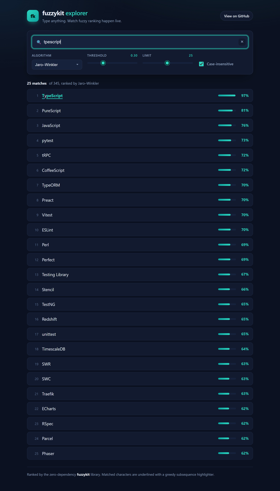

# fuzzykit

[](https://github.com/BoogeyCodes/fuzzykit/actions/workflows/ci.yml)


**fuzzykit** is a zero-dependency string-similarity and fuzzy-search toolkit for TypeScript, plus an
interactive **explorer** that makes ranking visible. Type a query — even a misspelled one — and watch
a catalogue of languages, frameworks and tools re-rank live, each result showing its similarity score
and the exact characters that matched.



## The explorer

A small Vite single-page app (in `web/`) built directly on the library. It is the fastest way to get
a feel for how each algorithm behaves.

- **Live ranking** as you type, over a few hundred real programming languages, frameworks, libraries,
  databases and tools.
- **Controls that map 1:1 to the library:** algorithm selector (Jaro–Winkler / Sørensen–Dice /
  Levenshtein), a threshold slider, a result limit, and a case-insensitive toggle — all re-rank
  instantly.
- **Score + highlight on every row:** the similarity as a percentage and a bar, and the matched
  characters underlined via a greedy case-insensitive subsequence match (separate from the numeric
  score).
- **Shareable:** the current query lives in the URL (`?q=` or `#q=`), so links reproduce a search.
- Dark theme, teal accent, responsive down to phone width, keyboard-navigable (arrow keys move the
  active row).

```bash
npm install
npm run dev        # explorer on http://localhost:5173
```

Build a static bundle (to `dist-web/`) or preview it:

```bash
npm run build:web
npm run preview
```

A multi-stage `Dockerfile` (Node build → nginx) serves the same static app:

```bash
docker build -t fuzzykit-explorer .
docker run -p 8080:80 fuzzykit-explorer
```

All of the ranking-to-view logic lives in a DOM-free, unit-tested module (`web/model.ts`): it takes
a query plus the control settings and returns a view model (ranked rows with score and highlight
ranges), so the behaviour is testable without a browser.

## The library

String similarity and fuzzy search with no runtime dependencies, shipped as both ESM and CommonJS
with type definitions.

```ts
import { search } from 'fuzzykit'

const commands = ['commit', 'checkout', 'clone', 'branch', 'merge', 'rebase', 'status']

search('chekout', commands, { limit: 3 })
// [ { item: 'checkout', score: 0.97 }, ... ]
```

### The measures

| Function | What it measures | Best for |
| --- | --- | --- |
| `levenshtein` / `levenshteinSimilarity` | Minimum single-character edits | general-purpose, typos |
| `jaro` / `jaroWinkler` | Matching characters, transpositions, shared prefix | short strings, names |
| `diceCoefficient` | Shared adjacent-letter pairs (bigrams) | longer phrases, word order |
| `jaccardSimilarity` | Set of distinct shared bigrams over their union | stricter, repeat-insensitive |

```ts
import { levenshtein, jaroWinkler, diceCoefficient, jaccardSimilarity } from 'fuzzykit'

levenshtein('kitten', 'sitting')        // 3
jaroWinkler('MARTHA', 'MARHTA')         // 0.961
diceCoefficient('healed', 'sealed')     // 0.8
jaccardSimilarity('night', 'nacht')     // 0.142
```

Every similarity function returns a value in `0–1` (`1` is identical); `levenshtein` itself returns
the raw edit distance, with `levenshteinSimilarity` for the normalised form.

### Fuzzy search

```ts
import { search, bestMatch } from 'fuzzykit'

// strings
search('aple', ['apple', 'maple', 'grape'])            // apple first

// objects, by a key
const users = [{ name: 'Alice Johnson' }, { name: 'Alicia Jones' }]
search('alice', users, { key: (u) => u.name })

// the single closest match, or null
bestMatch('bananna', ['banana', 'panama'])             // { item: 'banana', score: ... }
```

Options:

| Option | Default | Meaning |
| --- | --- | --- |
| `key` | — | For objects, the field to match against |
| `algorithm` | `'jaro-winkler'` | `'jaro-winkler'`, `'dice'` or `'levenshtein'` |
| `threshold` | `0.3` | Drop results scoring below this |
| `limit` | all | Keep at most this many |
| `caseInsensitive` | `true` | Lower-case both sides before comparing |

A case-insensitive **substring** match scores a perfect `1`, so exact and prefix matches always rank
above approximate ones.

### Install

```bash
npm install fuzzykit
```

Node 18+. Ships as ESM and CommonJS with type definitions. No runtime dependencies. The explorer app
is development-only and is not part of the published package.

## Implementation notes

- **Levenshtein** uses the two-row dynamic-programming recurrence, so memory is `O(min(a, b))` rather
  than the full matrix.
- **Jaro–Winkler** counts matches within the standard sliding window, halves the transpositions, and
  boosts a shared prefix of up to four characters.
- **Dice** counts shared bigrams by multiplicity (a repeated pair matches as many times as it
  appears), not mere presence.
- **Jaccard** compares the *sets* of distinct bigrams: shared pairs over the union of pairs.
- **Highlighting** (explorer only) is a greedy left-to-right subsequence scan — it marks the earliest
  run of characters that spell out the query — and is deliberately independent of the numeric score.

## Development

```bash
npm install
npm run typecheck      # lib + tests
npm run typecheck:web  # explorer
npm test               # 43 tests: the four measures, search, and the explorer view model
npm run build          # ESM + CJS + .d.ts via tsup
npm run build:web      # static explorer bundle via Vite
```

CI runs on Linux and Windows across Node 18/20/22: typecheck (lib and web), tests, and both builds.

## License

MIT
